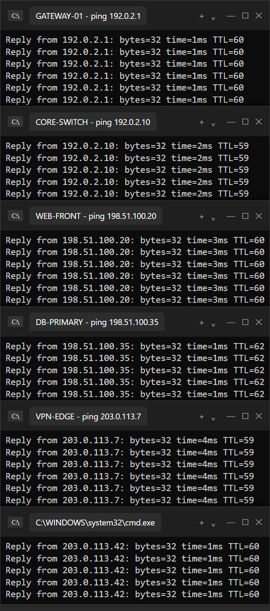
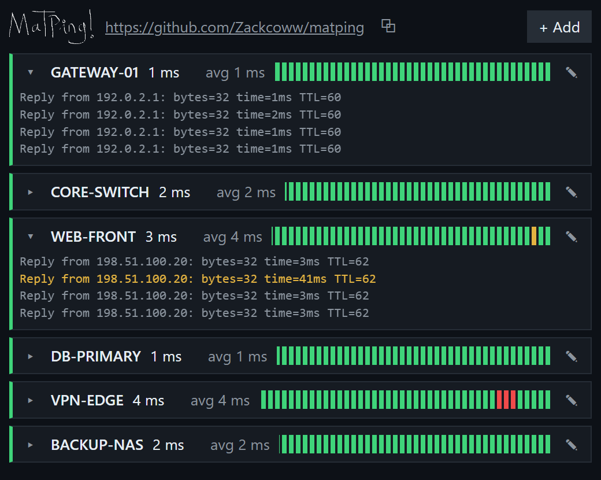

<div align="center">


# MatPing

**Simple, lightweight ping monitor from local computer (Windows ofkors).**<br>
One window instead of a stack of `ping -t` cmd windows.

[Download](../../releases/latest) · [MIT License](LICENSE)

<table>
<tr>
<td align="center"><b>Before</b><br>a stack of cmd windows</td>
<td align="center"><b>After</b><br>one MatPing window</td>
</tr>
<tr>
<td valign="top"></td>
<td valign="top"></td>
</tr>
</table>

</div>

- very lightweight usage 300ms - 500ms cold start
- Save a list of targets (name + IP or host); add, edit, delete, drag to reorder.
- Every target pings non-stop in the background (Windows' own `ping.exe`, no admin needed).
- Each card shows the latest and average latency and a status bar of the last 60 pings:
  green = reply, yellow = latency spike, red = timeout / unreachable.
- Raw `ping` output per card, collapsible.
- Responsive grid: one column in a thin window, many columns full screen.
- Starts with Windows and resumes pinging on launch.

## Install

Download `MatPing_x.y.z_x64-setup.exe` from [Releases](../../releases) and run it. No admin rights needed.

## Build from source

Needs [Rust](https://rustup.rs), Node.js 22+ and pnpm, plus the
[Tauri prerequisites](https://tauri.app/start/prerequisites/) for Windows.

```bash
pnpm install
pnpm tauri build
```

The installer lands in `src-tauri/target/release/bundle/nsis/`. Run `pnpm tauri dev` for a dev build.

Built with Tauri 2, React 19, TypeScript and Rust.

## License

[MIT](LICENSE)
